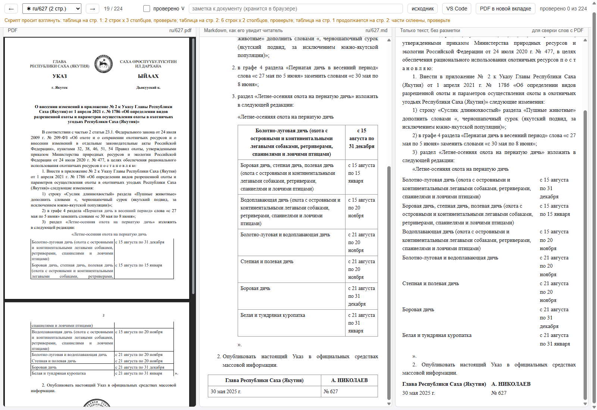

# Перевод указов из PDF в Markdown. Гайд для пользователя

Программа берёт папку с PDF-файлами указов Главы Республики Саха (Якутия) и делает из каждого
файл Markdown: заголовок, абзацы, пункты и подпункты, таблицы, подписной блок, приложения.
Работает на русских и якутских текстах, без интернета и без нейросетей. То, что получилось,
нужно просмотреть глазами, для этого есть страница проверки: слева PDF, рядом результат.

Гайд рассчитан на человека, который не работает с командной строкой. Все действия делаются
двойным щелчком по файлу и ответами на вопросы в окне.

## 1. Что понадобится

- Компьютер с Windows 10 или 11. На Linux и macOS тоже работает, команды в конце гайда.
- Python версии 3.8 или новее. Это бесплатная программа, ставится один раз.
- Интернет один раз, чтобы скачать программу и одну библиотеку. Дальше интернет не нужен.
- PDF-файлы с текстовым слоем. Если PDF это скан, то есть картинка без текста, программа его не прочитает.

## 2. Установка Python

Если Python уже стоит, пропустите этот раздел. Проверить просто: нажмите Win+R, введите `cmd`,
нажмите Enter и в чёрном окне наберите `python --version`. Если видите номер версии 3.8 или
больше, всё есть.

1. Откройте https://www.python.org/downloads/ и нажмите большую кнопку Download Python.
2. Запустите скачанный файл.
3. В первом окне установщика **обязательно поставьте галочку «Add python.exe to PATH»** внизу окна.
   Без неё программа не найдёт Python.
4. Нажмите Install Now и дождитесь окончания.

## 3. Установка программы

1. Откройте страницу программы на GitHub: https://github.com/zamena1985/pdf2md-ukazy
2. Нажмите зелёную кнопку **Code**, затем **Download ZIP**.
3. Распакуйте архив в удобное место, например `D:\pdf2md-ukazy`. Внутри должны лежать файлы
   `start.bat`, `install.bat`, `pdf2md.py` и папка `review`.
4. Запустите двойным щелчком **install.bat**. Откроется окно, в нём скачается библиотека для чтения PDF.
   В конце появится надпись «Done. Now run start.bat». Нажмите любую клавишу, окно закроется.

Этот шаг делается один раз. Если окно пишет «Install failed», скорее всего Python поставлен
без галочки «Add python.exe to PATH». Переустановите Python с галочкой и повторите.

## 4. Как разложить PDF

Программа ждёт одну папку, внутри которой две подпапки: `ru` для русских текстов и `sah` для
якутских. Имя файла это номер указа:

```
указы\
   ru\
      543.pdf
      559.pdf
      1002.pdf
   sah\
      543.pdf
      559.pdf
      1002.pdf
```

Если указы только на одном языке, достаточно одной подпапки. Имя файла важно: по номеру из
имени программа находит подписной блок «№ 543» в конце указа. Имена вида `Указ 543.pdf` тоже
подойдут, лишние буквы отбрасываются, а вот `указ_2025_543.pdf` собьёт поиск.

## 5. Запуск

Запустите двойным щелчком **start.bat**. Программа задаст три вопроса.

```
Перевод указов из PDF в Markdown
----------------------------------
Папка с PDF (внутри должны быть подпапки ru и sah; путь можно вставить или перетащить папку в окно): D:\указы
Папка для результата [D:\markdown]:
Ставить красную строку у абзацев (&emsp;&emsp; в начале абзаца)? (Д/н):
```

- **Папка с PDF.** Проще всего перетащить папку из Проводника прямо в чёрное окно, путь подставится сам. Затем Enter.
- **Папка для результата.** Можно просто нажать Enter, тогда папка `markdown` появится рядом с папкой PDF.
- **Красная строка.** Enter означает «да»: у абзацев будет отступ первой строки, как в оригинале.
  Ответ «н» даёт более чистый файл без отступов. Подробнее в разделе «Вопросы».

Дальше программа работает сама, на 200 файлов уходит около минуты. В конце она пишет, где лежат
файлы, и предлагает открыть страницу проверки. Enter откроет её в браузере.

В папке результата появятся подпапки `ru` и `sah` с файлами `.md`, а также `report.json` с
замечаниями программы и `docs.json` для страницы проверки.

## 6. Страница проверки

Страница открывается в браузере по адресу вида `http://127.0.0.1:8765/review.html`. Работает она
только пока открыто чёрное окно программы. Интернет не нужен, наружу ничего не уходит.



Три колонки:

- **PDF**, оригинал.
- **Markdown, как его увидит читатель**: результат в том виде, в каком его покажет облако или GitHub.
- **Только текст**: тот же результат без знаков разметки, удобно сверять слова с PDF.

Управление:

| Действие | Как |
|---|---|
| Следующий или предыдущий документ | стрелки → и ← на клавиатуре или кнопки в шапке |
| Отметить документ проверенным | клавиша V или галочка «проверено». Отметка сохраняется в браузере |
| Оставить заметку | поле «заметка к документу» в шапке, сохраняется само |
| Перейти к нужному документу | выпадающий список в шапке |
| Открыть PDF целиком | кнопка «PDF в новой вкладке» |
| Увидеть исходный текст Markdown | кнопка «исходник» |

В списке документов значок **✱** стоит у тех файлов, по которым у программы есть замечания.
Сами замечания показаны жёлтой строкой под шапкой. Такие файлы смотрите внимательнее, остальные
можно листать быстрее.

Что сверять в каждом документе:

1. Заголовок указа на месте, один, целиком.
2. Абзацы делятся там же, где в PDF: ничего не склеилось и не разорвалось.
3. Пункты «1.» и подпункты «1)» идут с теми же номерами, что в PDF.
4. Таблицы: столько же строк и столбцов, ничего не потеряно.
5. В конце таблица подписи: должность, фамилия, дата, номер. Приложения идут после неё со своими заголовками.

## 7. Что значат замечания

| Замечание | Что это и что делать |
|---|---|
| дефис на границе строки склеен без пробела | слово с дефисом было перенесено на следующую строку, части склеены без пробела, например «сирдээҕи-уоттааҕы». Убедитесь, что получилось одно слово, а не два |
| таблица на стр. N: R строк x C столбцов | найдена таблица. Сверьте число строк и столбцов с PDF |
| таблица на стр. N продолжается на стр. N+1: части склеены | таблица была разорвана страницей, программа соединила части. Сверьте место стыка |
| число столбцов разное, склейте вручную | две части похожи на одну таблицу, но столбцов разное число. Программа оставила их отдельно, соедините в редакторе |
| сетка без видимых границ оставлена текстом | в PDF была невидимая таблица вёрстки, текст оставлен абзацами. Обычно это правильно |
| нумерация: после пункта «2)» идёт «13.» | внутри пункта начинается другая нумерация, обычно это вставляемый текст. Он оформлен вложенным списком. Сверьте с PDF |
| подписной блок не распознан | не удалось собрать таблицу подписи. Оформите её вручную по образцу из соседнего файла |
| ПОЛНОТА: в Markdown N% знаков от исходника | число знаков заметно отличается от PDF, возможен пропуск или дубль. Пролистайте документ целиком |
| приложение «Структура» это схема из блоков | организационная схема. В тексте только подписи блоков, расположение придётся оформить вручную |
| НЕТ ТЕКСТОВОГО СЛОЯ | PDF это скан. Программа его не читает, нужен отдельный инструмент распознавания |

## 8. Как исправить файл вручную

Файл `.md` это обычный текст. Откройте его в любом редакторе: Блокнот, Notepad++, VS Code.
Внесите правку и сохраните. Страница проверки перечитывает файл, когда вы возвращаетесь в
браузер, поэтому результат виден сразу.

Коротко о разметке, чтобы не сломать её:

- `# Заголовок` это заголовок, решётка и пробел в начале строки.
- Пустая строка между абзацами обязательна. Без неё два абзаца сольются в один.
- `1. Текст` и `   1) Текст` это пункты списка. Подпункты сдвинуты на три пробела, таблицы и абзацы внутри подпункта на шесть.
- `**жирный**`, `*курсив*`.
- Таблица: строки из ячеек через `|`, вторая строка `|---|---|` отделяет шапку.
- `\*` в начале строки это обычная звёздочка сноски. Без косой черты она превратится в маркер списка.

## 9. Загрузка в облако

Файлы загружаются в облако лаборатории в папку исполнителя, внутри неё `ru` и `sah`. Перетащите
файлы из папки результата в браузер. Если облако спросит про совпадающие имена, оставьте
галочку только на «New files»: старые файлы заменятся новыми.

## 10. Вопросы

**Почему подпункты показываются как «1.», а не «1)»?** Так рисует просмотрщик. В файле записано
«1)», но для Markdown это просто «нумерованный список», а номера он подписывает своим стилем.
Из файла это не меняется.

**Что такое `&emsp;&emsp;` в начале абзацев?** Это запись широкого пробела буквами. Облако
показывает вместо неё отступ первой строки. Если файлы пойдут не на чтение, а в обработку,
например для обучения языковых моделей, лучше отвечать «н» на вопрос про красную строку:
файл будет чище.

**Почему заголовок не по центру, а «Приложение» не справа?** Выравнивания в Markdown нет.
Текст всегда идёт по левому краю, структура при этом сохраняется.

**Герб, печать, шапка «УКАЗ / ЫЙААХ» не перенесены.** Так и задумано, это оформление бланка, а не текст.

**Программа написала «подписной блок не распознан».** Чаще всего имя файла не совпадает с
номером указа. Переименуйте файл в номер и запустите снова.

**Нужно обработать один новый файл, а не все.** Положите его в ту же папку PDF и запустите
start.bat снова: обработаются все файлы, это быстро, а отметки «проверено» на странице не пропадут.

## 11. Linux и macOS

В терминале, из папки программы:

```
pip3 install -r requirements.txt
python3 start.py
```

Или без вопросов:

```
python3 pdf2md.py /путь/к/pdf /путь/к/результату --indent
python3 review.py --pdf /путь/к/pdf --md /путь/к/результату
```

## 12. Если что-то пошло не так

- **start.bat сразу закрывается или пишет «Python not found».** Python не установлен или поставлен
  без галочки «Add python.exe to PATH». Раздел 2.
- **«Не установлена библиотека PyMuPDF».** Не выполнен install.bat. Раздел 3.
- **Страница проверки не открывается.** Чёрное окно программы закрыто. Запустите start.bat снова
  и ответьте «д» на последний вопрос, либо откройте страницу командой из раздела 11.
- **Страница показывает старую версию файлов.** Нажмите Ctrl+F5 в браузере.

Вопросы и ошибки можно писать на странице программы в разделе Issues:
https://github.com/zamena1985/pdf2md-ukazy/issues
